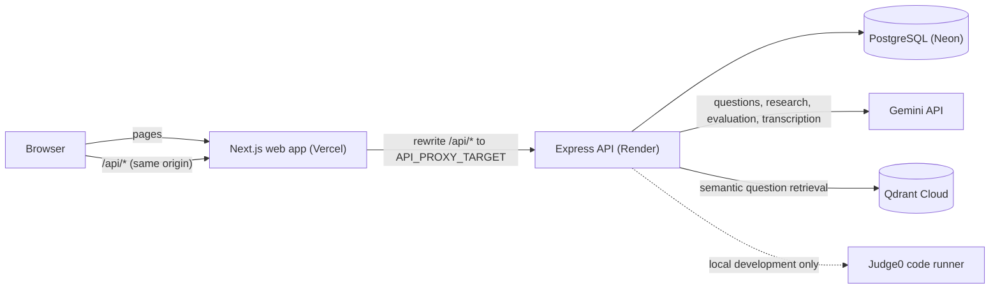

# IntervAI

**Practise the hard parts of the interview.**

IntervAI is a full-stack interview practice platform. It plans an interview around a topic, your resume, or both, then evaluates your answers with AI and saves a report you can come back to.

**Live demo:** [intervai-web-one.vercel.app](https://intervai-web-one.vercel.app)

---

## Overview

Preparing for technical interviews usually means switching between question lists, a code editor, and guesswork about how good an answer really is. IntervAI puts that loop in one place:

1. **Set up** an interview: mode (topic, resume or mixed), type, difficulty, focus area, target role and time limit.
2. **Answer** questions one at a time in a text editor (or by voice). Coding questions open a browser IDE.
3. **Get evaluated.** Each answer is scored with strengths, improvements and a sample answer, and the interview produces an overall report.
4. **Come back.** Reports, progress and unfinished interviews are saved to your account and summarised on a dashboard.

## Features

### Interview setup
- **Three modes:** *Topic* (a subject such as DBMS or System Design), *Resume* (questions about your own projects and experience), and *Mixed* (both in one interview).
- **Interview types:** Technical, Behavioral and HR.
- **Difficulty:** Easy, Medium or Hard.
- **Focus areas:** Data Structures & Algorithms, Operating Systems, DBMS, Computer Networks, OOP and System Design.
- **Time limit:** 15, 30, 45 or 60 minutes, enforced by the server.
- **Resume intake:** upload a PDF or Word (.docx) file, or paste text. The server extracts skills, projects and experience into a structured profile; the file itself is not stored.

### Questions
- **Planned interviews:** a question plan combines a curated question bank, semantic retrieval from a vector index (Qdrant), and AI-generated questions (Gemini). The plan is saved, so a refresh or resume never regenerates it.
- **Research-grounded questions:** for topic and mixed interviews, the server runs one Gemini call with Google Search grounding. Questions informed by that research show their **web sources** in the session and in the report. If research is unavailable, the interview falls back to the curated bank and says so.
- **Question provenance:** each question is labelled by origin, for example *From the question bank*, *Researched for this topic* or *Based on your resume*.

### Answering
- **Text answers** with a keyboard shortcut (Ctrl/⌘ + Enter) and automatic **draft recovery**: unsent text survives a refresh.
- **Voice answers:** record an answer in the browser and it is transcribed by Gemini into the editor for you to review. Transcription never submits on its own. Available on text-based questions.
- **Coding workspace:** a Monaco-based editor with C++, Python and Java templates, sample tests, resizable panes and a tabbed phone layout. Code drafts are saved per question and language. The workspace switches on automatically for coding questions.
- **Server-enforced timer:** the deadline is stored on the server, so refreshing the page doesn't reset it. When time runs out, only submitted answers are evaluated.

### Evaluation and history
- **Per-answer feedback:** score, summary, strengths, improvements and a sample answer.
- **Interview report:** an overall score and performance level across all answered questions, saved for later.
- **Dashboard:** recent reports, a performance summary and in-progress interviews you can **resume** where you left off.
- **Accounts:** email and password sign-up with server-side sessions in an HttpOnly cookie.

### Coding problem catalog
Coding questions map to a small catalog of problems with runnable harnesses: *Two Sum II*, *Valid Palindrome*, *Reverse Linked List*, *Linked List Cycle* and *Coin Change*. A coding question without a runnable problem is answered in text instead of opening an empty editor.

## Screenshots and demo

Try the live application at **[intervai-web-one.vercel.app](https://intervai-web-one.vercel.app)**. You can create an account there to run an interview end to end.

## Architecture

In production the browser only talks to the Next.js site. Requests to `/api/*` are proxied by Next.js to the Express API, so the session cookie stays first-party.



## Technology stack

| Layer | Technology | Role |
|---|---|---|
| Frontend | Next.js 16, React 19, TypeScript | App Router pages, `/api` proxy rewrite |
| UI | Tailwind CSS 4, Framer Motion, Lucide icons | Styling, animation and icons |
| 3D companion | Three.js, React Three Fiber, Drei | Animated AI coach on the landing, setup and session pages |
| Code editor | Monaco Editor (`@monaco-editor/react`) | In-browser coding workspace |
| API | Node.js, Express 5, TypeScript | REST API, auth, interview lifecycle, evaluation |
| Database | PostgreSQL with Prisma 8 (`@prisma/orm-postgres`) | Data access, contract and migrations |
| AI | Google Gemini (`@google/genai`) | Question generation, search-grounded research, evaluation, resume parsing, speech-to-text |
| Vector search | Qdrant (`@qdrant/js-client-rest`) | Semantic retrieval from the question bank |
| Auth | argon2 password hashing, server-side sessions | Accounts and session cookies |
| Documents | mammoth | Reading .docx resumes |
| Code execution | Judge0 (self-hosted, Docker) | Running and testing code locally |

## Repository structure

```text
intervai/
├── apps/
│   ├── web/              # Next.js frontend (pages, components, client libraries)
│   │   └── src/
│   │       ├── app/      # Routes: /, /login, /signup, /dashboard, /interview,
│   │       │             #         /interview/session, /reports, /reports/[interviewId]
│   │       ├── components/
│   │       └── lib/      # API client, session/resume helpers, voice recorder
│   └── api/              # Express API
│       ├── src/
│       │   ├── modules/  # auth, interviews, evaluations, coding, ai, health
│       │   ├── prisma/   # Prisma contract (contract.prisma) and generated types
│       │   ├── app.ts    # Express app: CORS, CSRF origin check, routes
│       │   └── server.ts # Entry point (listens on PORT, default 4000)
│       └── scripts/
│           └── index-question-bank.ts   # Embeds the question bank into Qdrant
├── migrations/           # Prisma migration history and contract snapshots
├── judge0/               # Docker Compose setup for a local Judge0 runner
├── compose.yml           # Local PostgreSQL container
├── prisma.config.ts      # Prisma CLI configuration (local and production)
├── render.yaml           # Render Blueprint for the API
└── .env.example          # Documented environment variables
```

## How it works

1. **Create:** the setup page posts the chosen mode, type, difficulty, focus area, role and duration to `POST /api/interviews`. A client request ID makes retries idempotent.
2. **Plan:** the API optionally runs one search-grounded research call, then builds a question plan from curated questions, Qdrant retrieval and Gemini generation. The plan and any source references are stored with the interview.
3. **Start:** `POST /api/interviews/:id/start` sets the server-side start time and deadline. It's idempotent, so refreshing doesn't restart the clock.
4. **Answer:** text answers go to `.../questions/:questionId/answer`. Coding solutions are run and submitted through the coding endpoints. Voice recordings are transcribed through `POST /api/interviews/:id/transcribe` and returned as text only. Every submission checks ownership and the deadline.
5. **Evaluate:** answers are evaluated by Gemini. When all questions are answered, or time runs out, the API generates and stores an evaluation report.
6. **Review:** reports are listed at `/reports`, summarised on `/dashboard`, and unfinished interviews can be resumed from the dashboard.

## Getting started

### Prerequisites
- **Node.js 22** and **npm 10**
- **Docker** (for the local PostgreSQL database, and optionally Judge0)
- A **Google Gemini API key**
- A **Qdrant** cluster URL and API key (for example a free Qdrant Cloud cluster)

### 1. Clone and install

```bash
git clone https://github.com/Sparshsinghx19/IntervAI.git
```

```bash
cd IntervAI
```

```bash
npm install
```

The repository is an npm workspaces monorepo; installing at the root installs both apps. The root `.npmrc` sets `legacy-peer-deps=true`, which this lockfile needs.

### 2. Configure the environment

```bash
cp .env.example .env
```

Fill in the values in `.env` (see [Environment variables](#environment-variables)). The API reads the root `.env`. The web app needs no file locally: it defaults to the API at `http://localhost:4000`.

### 3. Start PostgreSQL and apply migrations

```bash
docker compose up -d
```

```bash
npx prisma db migrate
```

`docker compose` starts PostgreSQL using the `POSTGRES_*` values from `.env`. `npx prisma db migrate` (run from the repository root) applies the migrations in `migrations/` to `DATABASE_URL`.

### 4. Index the question bank (optional)

Semantic question retrieval needs the question bank in Qdrant. From `apps/api`:

```bash
npx tsx scripts/index-question-bank.ts
```

This creates or updates the `intervai_question_bank` collection using Gemini embeddings. Without it, interviews still work using the curated bank.

### 5. Run the API and the web app

In two terminals, from the repository root:

```bash
npm run dev --workspace=api
```

```bash
npm run dev --workspace=web
```

Open [http://localhost:3000](http://localhost:3000). The API listens on [http://localhost:4000](http://localhost:4000), with health checks at `/health` and `/health/ready`.

### Optional: local code execution (Judge0)

Running and submitting code needs a Judge0 runner. A Docker Compose setup is provided in `judge0/`. Set `JUDGE0_BASE_URL` (default `http://localhost:2358`) to point the API at it. Submissions also need private hidden test cases, read from the database or from the Git-ignored `apps/api/data/private-hidden-tests.json`.

### Running tests

Both apps use Node's built-in test runner through `tsx`. The API tests expect the local database to be running.

```bash
cd apps/api && npx tsx --test "src/**/*.test.ts"
```

```bash
cd apps/web && npx tsx --test "src/**/*.test.ts"
```

## Environment variables

All names are documented in [`.env.example`](.env.example). Never commit real values.

### API (`apps/api`)

| Variable | Required | Purpose |
|---|---|---|
| `DATABASE_URL` | Yes | PostgreSQL connection string used by the API at runtime. |
| `GEMINI_API_KEY` | Yes | Google Gemini API key (server-side only). |
| `GEMINI_MODEL` | No | Gemini model name. Defaults to `gemini-2.5-flash`. |
| `QDRANT_URL` | Yes | Qdrant cluster endpoint. |
| `QDRANT_API_KEY` | Yes | Qdrant API key. |
| `FRONTEND_ORIGINS` | Yes | Exact web origin(s), comma-separated. Used for credentialed CORS and the CSRF origin check. |
| `AUTH_SESSION_TTL_HOURS` | No | Session lifetime in hours. Defaults to 168 (7 days). |
| `AUTH_COOKIE_SAMESITE` | No | `lax` (default), `strict` or `none`. `none` forces the Secure flag. |
| `TRUST_PROXY` | No | Express "trust proxy" setting when running behind proxies, so rate limiting sees real client IPs. |
| `CODE_EXECUTION_ENABLED` | No | Set to `false` to disable code execution. Coding questions are then answered in text. Defaults to enabled. |
| `JUDGE0_BASE_URL` | No | Judge0 runner URL. Defaults to `http://localhost:2358`. |
| `JUDGE0_AUTH_TOKEN` | No | Token for an authenticated Judge0 instance. |
| `JUDGE0_AUTH_HEADER` | No | Header name for the Judge0 token. Defaults to `X-Auth-Token`. |
| `PORT` | No | Port the API listens on. Defaults to 4000 (hosting platforms set this). |
| `NODE_ENV` | No | Set to `production` in deployments. Enables Secure cookies. |

### Web (`apps/web`)

| Variable | Required | Purpose |
|---|---|---|
| `NEXT_PUBLIC_API_URL` | No | API base URL. Defaults to `http://localhost:4000`. Use `same-origin` in production to call this site's own `/api` path. |
| `API_PROXY_TARGET` | Production | Origin of the Express API that `/api/*` is proxied to. |

### Database tooling and local Docker

| Variable | Purpose |
|---|---|
| `POSTGRES_USER`, `POSTGRES_PASSWORD`, `POSTGRES_DB` | Credentials for the local PostgreSQL container in `compose.yml`. |
| `DIRECT_URL` | Production only: the direct (non-pooled) database connection for migrations, kept in the Git-ignored `.env.production.local`. |
| `PRISMA_ENV_FILE` | Production only: tells `prisma.config.ts` to use that file's `DIRECT_URL` for migrations. |

## Deployment

The project is set up for this topology:

| Component | Platform | Configuration |
|---|---|---|
| Web app | **Vercel** | Root directory `apps/web`. `NEXT_PUBLIC_API_URL=same-origin` and `API_PROXY_TARGET` set to the API's origin. |
| API | **Render** | [`render.yaml`](render.yaml) Blueprint: installs from the monorepo root, builds with `npm run build --workspace=api`, starts with `npm run start --workspace=api`, health check `/health/ready`. Secrets are entered in Render, not committed. |
| Database | **Neon** PostgreSQL | The API uses the **pooled** connection string (`DATABASE_URL`). Migrations use the **direct** connection (`DIRECT_URL`). |
| Vector search | **Qdrant Cloud** | The `intervai_question_bank` collection (768-dimension Gemini embeddings, cosine distance). |
| AI | **Google Gemini** | Server-side API key only. |

Production migrations run from a developer machine with the direct connection string, kept in the Git-ignored `.env.production.local`:

```bash
PRISMA_ENV_FILE=.env.production.local npx prisma db migrate
```

With `PRISMA_ENV_FILE` set, `prisma.config.ts` only uses that file's `DIRECT_URL`, and stops with an error instead of falling back to a local database.

## Current limitations

- **Hosted code execution is disabled.** The production API runs with `CODE_EXECUTION_ENABLED=false` (see `render.yaml`) because there is no isolated production code runner yet. In the hosted app, coding questions are answered in text and Run Code / Submit Solution never reach a runner. Code execution works locally with Judge0.
- **The coding catalog is small:** five runnable problems.
- **Free-tier hosting:** the Render free plan sleeps when idle, so the first request after a pause can be slow.
- **Transcription is tuned for English**, and recordings are limited to 3 minutes.

## Security notes

- **Never commit secrets.** `.env`, `.env*.local` and the private hidden-test file are Git-ignored. Keep API keys and database URLs in local env files or your hosting provider's settings.
- **Keys stay server-side.** The Gemini, Qdrant and Judge0 credentials are only read by the API; nothing secret is exposed to the browser.
- **Sessions:** passwords are hashed with argon2. Sessions use an HttpOnly cookie that is Secure and `__Host-`-prefixed in production.
- **Requests:** state-changing API requests must come from an allowed origin (`FRONTEND_ORIGINS`). Login and registration are rate-limited, and every interview route checks ownership.
- **Data minimisation:** uploaded resumes and voice recordings are processed in memory and not stored, and the resume, transcription and research paths log only error types, never their content.
- **If a key leaks, rotate it** at the provider (Gemini, Qdrant, Neon) and update your environment settings.

## License

No license has been provided for this repository. All rights are reserved by the author unless a license is added.
